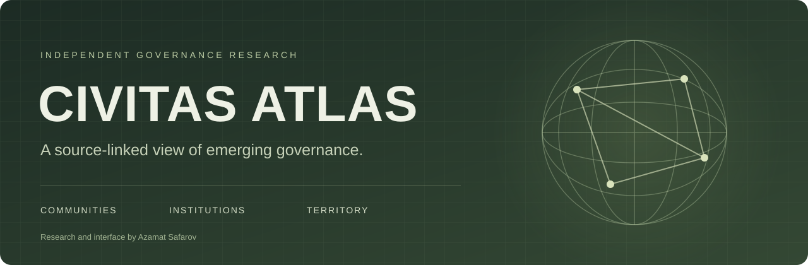

<div align="center">


# CIVITAS ATLAS

**A research atlas of communities, experimental cities and emerging forms of governance.**

[](https://polis-network-atlas.vercel.app)
[](LICENSE)
[](CONTRIBUTING.md)

[Explore](https://polis-network-atlas.vercel.app) - [Scope](#research-scope) - [Quick start](#quick-start) - [Contribute](#contributing) - [Русский](README.ru.md)



</div>

## Why this atlas

New communities and governance initiatives are scattered across directories, project websites and technical documents. CIVITAS ATLAS brings these sources into a searchable catalog and geographic interface for comparative research.

It covers **network-state projects, digital and intentional communities, experimental cities, special economic zones and micronations**. These are different institutional forms, not interchangeable kinds of sovereign state.

The project is curated by **Azamat Safarov**. The original contribution is source integration, duplicate review, classification, provenance, coordinate review and interface development. Original source authors retain credit for their texts and media.

## Explore

| Resource | What it provides |
|---|---|
| [Live atlas](https://polis-network-atlas.vercel.app) | Search, project profiles, a globe and a flat map |
| [About the project](https://polis-network-atlas.vercel.app/about.html) | Purpose, sources, curation and limitations |
| [For the press](https://polis-network-atlas.vercel.app/media.html) | A reusable project description and press contacts |
| [CHRONOTOPE](https://civitas-chronotope.vercel.app) | A separate historical timeline for comparative research |

Compare membership, collective decisions, shared resources, geography and relations with states. Follow the source references before treating a project statement as an established fact.

## Research scope

The website's published research snapshot contains **166 records**:

| Section | Records |
|---|---:|
| Main catalog | 126 |
| Archive | 4 |
| Status unconfirmed | 36 |

Archive does not necessarily mean a community has disappeared. Unconfirmed does not mean closed. Map markers may represent approximate areas or historical sites, not current headquarters or borders.

> [!IMPORTANT]
> This is a selected research snapshot, not a worldwide census or a list of recognised sovereign states. Source claims and current activity are not all independently verified. **MIT covers original code, not the entire dataset or third-party media.**

The repository's legacy research snapshot and source index are separate from the website's current publication selection. See [DATASET-SCOPE.md](DATASET-SCOPE.md) for their contents and limits.

## Quick start

**To browse projects, use the [live atlas](https://polis-network-atlas.vercel.app).**

To run the self-contained contribution portal locally, install Python 3 and Git, then:

```bash
git clone https://github.com/AzamatSafarov/civitas-atlas.git
cd civitas-atlas
python preview.py
```

Open **http://127.0.0.1:8850**. No Python packages or API keys are required for this portal.

Validate original submissions with:

```bash
python scripts/validate_submissions.py
```

<details>
<summary><strong>What this checkout runs</strong></summary>

The contribution portal is separate from the complete live atlas. This repository contains frontend files, a legacy research snapshot and contribution tools, but not every production vendor or media asset. A checkout is not a complete reproduction of the live globe. Production publication and submission validation are currently manual.

</details>

## Repository guide

```text
civitas-atlas/
├── assets/                       # README artwork and share card
├── data/
│   ├── community-submissions.json # Original submissions awaiting review
│   └── source-index.json          # Legacy source-reference index
├── portal/                       # Standalone contribution portal
├── scripts/validate_submissions.py
├── combined-v3.json              # Legacy research snapshot, not blanket open data
├── preview.py                    # Local contribution-portal server
├── DATASET-SCOPE.md              # Snapshot boundaries and record counts
├── CONTRIBUTING.md               # Submission and review requirements
├── RIGHTS.md                     # Attribution, permissions and rights requests
└── README.md
```

## Contributing

**[Suggest a project](https://github.com/AzamatSafarov/civitas-atlas/issues/new?template=project.yml)** or [report a correction](https://github.com/AzamatSafarov/civitas-atlas/issues/new).

Provide an official website, an original description, a location or explicit virtual status, and supporting sources. You can also open a pull request against `data/community-submissions.json`. See the [contribution guide](CONTRIBUTING.md) for the required fields.

**Submission → source and rights review → editorial decision → manual publication.** Acceptance is not automatic, and it does not establish statehood. Do not submit private personal data, credentials, copied promotional text or unlicensed images.

## Project status

- [x] Public research atlas and source-linked project profiles
- [x] Search and geographic browsing on the website
- [x] GitHub project-submission form and local validation tool
- [ ] Ongoing source, activity and rights review
- [ ] Automatic production deployment from this repository

## Rights and contact

| Material | Terms |
|---|---|
| Original project code | [MIT](LICENSE) |
| Authorised original community submissions | CC BY 4.0, with contributor attribution |
| Legacy records, third-party descriptions, photographs and symbols | Upstream rights; no blanket reuse permission established |

See [Rights](RIGHTS.md), [Privacy](PRIVACY.md) and [Security](SECURITY.md). This project is independent and does not imply endorsement by listed organisations. It provides no legal, investment or immigration advice.

**Press, corrections and rights requests:** [akutagavasora777@gmail.com](mailto:akutagavasora777@gmail.com) · [Telegram](https://t.me/Azamat_Safar0v)

---

<div align="center">

**Research and interface by [Azamat Safarov](https://github.com/AzamatSafarov)**

[Visit CIVITAS ATLAS](https://polis-network-atlas.vercel.app) - [Read in Russian](README.ru.md)

</div>
